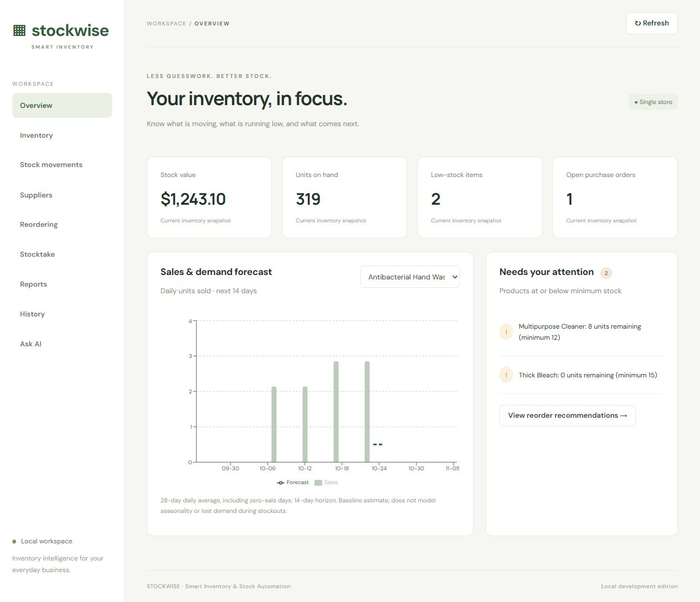
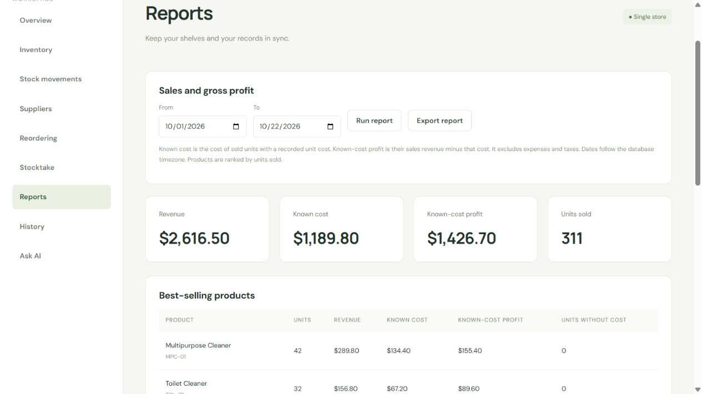

# Stockwise Smart Inventory

A web application that helps small businesses manage stock, track sales, plan replenishment, and understand product profitability.

## Features

- Dashboard with stock value, low-stock alerts, and a baseline demand forecast.
- Product and supplier management with add, edit, and delete controls.
- Popup forms for sales, receipts, stock adjustments, and purchase orders.
- Reorder recommendations with editable order quantities and partial deliveries.
- Stocktakes, change history, and CSV import and export.
- Date-range reports with revenue, known cost, known-cost profit, and best sellers.
- Ask AI with a labelled demo mode and a live OpenAI integration. Proposed changes require confirmation.

## Application preview





[Application showcase PDF](Stockwise%20Smart%20Inventory.pdf)

## Technology stack

| Layer | Technologies |
| --- | --- |
| Frontend | React 19, TypeScript, Vite 7, CSS |
| Charts | Recharts 3 |
| Backend | Node.js, Express 5, TypeScript |
| Database | PostgreSQL with pg |
| Validation and scheduled jobs | Zod, node-cron |
| AI integration | OpenAI Responses API |

## Requirements

- Node.js **22.12+** (Node 24 LTS recommended) and npm.
- Docker Desktop with Compose, or a local PostgreSQL 17 instance.
- Two terminal windows for the apps; Docker Desktop must stay running.

## Quick start on Windows (PowerShell)

Clone the repository and open PowerShell in the project folder:

```powershell
git clone https://github.com/lexander1993/SmartInventory.git
cd SmartInventory
```

### 1. Start the database

```powershell
docker compose up -d db
docker compose ps
```

Wait for `healthy`. The database is bound to localhost, port 5432. Local development credentials are in `docker-compose.yml`; do not reuse them for hosting.

### 2. Install dependencies and configure

From `SmartInventory`:

```powershell
npm run install:all
Copy-Item inventory-api/.env.example inventory-api/.env
Copy-Item inventory-frontend/.env.example inventory-frontend/.env
```

On macOS/Linux use `cp` instead of `Copy-Item`.

### 3. Initialize and start the backend (terminal 1)

```powershell
cd inventory-api
npm run db:migrate
npm run db:seed
npm run dev
```

Backend: http://localhost:3001/api/health (should show `{"status":"ok"}`).
The seed creates 14 cleaning products, one supplier, costed receipts and sales, and an open purchase order. It skips when any products already exist. Versioned migrations apply once and preserve existing records.

### 4. Start the frontend (terminal 2)

Open another terminal in `SmartInventory`:

```powershell
cd inventory-frontend
npm run dev
```

Open **http://localhost:5173**. Both frontend and backend must remain running. Stop either with Ctrl+C. Database data persists in the Docker volume.

## Workspace improvements

The app now includes order forms with partial deliveries, audit history, inventory filters, date-range sales and gross profit reports, CSV import/export, stocktakes, and an Ask AI assistant. Restart both apps after upgrading; the API applies versioned migrations at startup and opens directly to Overview. See [operations guide](docs/OPERATIONS.md) for workflow and CSV instructions.

## Ask AI

Ask AI can look up inventory, analyze replenishment, generate sales/profit reports, and prepare stock receipts, sales, adjustments, and purchase orders from prompts. Changes appear as reviewable cards and only apply when confirmed. Demo mode uses built-in cleaning-product scenarios without API credits or changes to the main inventory. For Live AI, set `OPENAI_API_KEY` in `inventory-api/.env` and restart the backend. Available API credits are required. Never commit API keys to GitHub. See [Ask AI setup and capabilities](docs/ASK_AI.md).

## Understanding reports

Known cost is the recorded cost of sold units with a unit cost. Known-cost profit is the revenue from those costed units minus their cost. It excludes operating expenses, taxes, and sales with missing costs.

## First workflow

1. Explore Overview for inventory value, low-stock alerts and sales forecasts.
2. Add/edit a supplier, including lead time in days.
3. Add a product under Inventory with a unique SKU and barcode. New products start at zero stock. Cost and price are AUD per unit; quantities are integer units.
4. In Stock movements select the product and record a receipt to add stock.
5. Focus the barcode input and scan with a USB/Bluetooth scanner configured as a keyboard with Enter suffix. You can type `930000001001` and press Enter to find Multipurpose Cleaner in the seeded inventory. The matched product is selected in the movement form. **Camera scanning is not included.**
6. Record sales; stock cannot go negative. Corrections use signed adjustment quantities (e.g. `-2` removes two units). Edit or delete a movement to correct it; stock balances update transactionally.
7. Reordering shows demand and suggested quantities. Create an internal purchase order, then use Receive stock when it arrives. Receiving adds stock once and writes an audit movement. Partial deliveries and delivery corrections are supported; emailing orders is not included.

## Structure

```text
SmartInventory/
  inventory-frontend/
    src/App.tsx             Dashboard, product/supplier forms, scanning, orders
    src/api.ts              Typed HTTP request helper
    src/style.css           Responsive UI
    .env.example
  inventory-api/
    src/app.ts              Express routes, validation, stock/order transactions
    src/db.ts               PostgreSQL connection pool
    src/forecast.ts         Reorder recommendation function
    src/jobs.ts             Scheduled stock alerts
    src/server.ts           Bootstrap and graceful shutdown
    src/migrate.ts          Schema initialization
    src/seed.ts             Demo inventory and sales
    db/001_init.sql         Tables, constraints, indexes
    test/forecast.test.ts   Recommendation tests
    .env.example
  docker-compose.yml        Local PostgreSQL
  docs/API.md               Endpoint reference
  docs/ARCHITECTURE.md      Rules, tradeoffs, extension points
  VALIDATION.md             Checks run on the delivered source
```

## Configuration

Backend `.env`:

| Variable | Meaning |
| --- | --- |
| DATABASE_URL | PostgreSQL connection URL |
| PORT | API port, default 3001 |
| FRONTEND_URL | Exact frontend CORS origin, default http://localhost:5173 |
| JOBS_ENABLED | Set false to disable scheduled alert refresh |
| ALERT_CRON | Default `*/15 * * * *`, refresh every 15 minutes |
| TZ | Database client/process timezone; use Australia/Sydney locally |

Frontend `.env`: `VITE_API_URL=http://localhost:3001/api`. Restart Vite after editing. Vite variables are public and must contain no secrets. For another frontend port update both Vite configuration and FRONTEND_URL.

If using your own PostgreSQL, create a database and user, change DATABASE_URL, and skip Docker. Use a dedicated empty development database. The normal seed preserves an existing inventory. A deliberate replacement command is documented in [operations](docs/OPERATIONS.md).

## Build and test

From the root:

```powershell
npm run build
npm test
```

Tests run against isolated in-memory PostgreSQL (PGlite) and do not touch your application database. See VALIDATION.md for the tested scope.

Backend compiled output: `inventory-api/dist`; run with `cd inventory-api` then `npm start` after configuring `.env` and initializing the database. Frontend output: `inventory-frontend/dist`; `npm run preview` from its folder serves a local production-build preview on port 4173. Set FRONTEND_URL to http://localhost:4173 and restart the API when using preview.

Dependencies are installed separately for each application. `node_modules` and local `.env` files are excluded from Git. If package lockfiles are present use `npm ci` in each application for reproducible installation.

## Scheduled automation

The API refreshes low-stock alerts at startup and every 15 minutes by default, with PostgreSQL advisory locking to serialize refreshes across instances. Reading `/api/alerts` also refreshes immediately. Alerts are persisted and cleared when replenished. They appear in the dashboard; no email/SMS provider is configured. Keep the API process alive for scheduled execution.

## Troubleshooting

- Database connection refused: start Docker Desktop, run `docker compose up -d db`, wait for healthy and check DATABASE_URL.
- Port 5432 occupied: change Compose host mapping (e.g. `5433:5432`) and DATABASE_URL port together.
- `relation products does not exist`: run `npm run db:migrate` in inventory-api.
- Frontend cannot connect: check API health, API terminal, VITE_API_URL and FRONTEND_URL. Do not open index.html directly.
- Duplicate SKU/barcode: choose a unique value. API responds with 409.
- Insufficient stock: receive inventory before recording sales.
- No recommendation: inventory position includes open orders; supplier assignment is needed before creating orders.
- `docker compose down` stops/removes the container but keeps data. `docker compose down -v` **deletes all local database data**; only use intentionally.

## Scope before production

This is a functional **local development application** with audit history and versioned migrations. It has no login or tenant isolation. API binds to localhost by default. Before exposing it, configure HTTPS, shared rate limiting, off-device scheduled backups, deployment configuration, and monitoring. Forecasts are estimates, not guaranteed demand. Review suggested orders before purchasing. Source references and design details are in docs/ARCHITECTURE.md.
